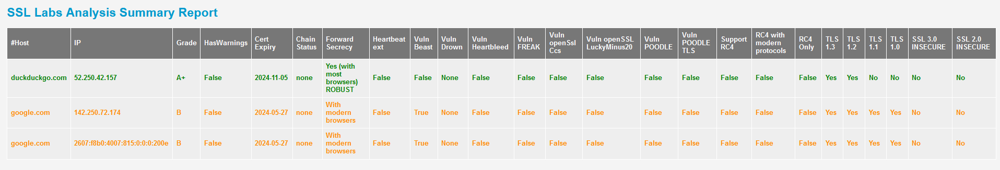

# SSL Labs Scan

[](https://github.com/kyhau/ssllabs-scan/actions/workflows/ci.yml)
[](https://app.codecov.io/gh/kyhau/ssllabs-scan/tree/main)
[](https://github.com/kyhau/ssllabs-scan/actions/workflows/codeql-analysis.yml)
[](https://github.com/kyhau/ssllabs-scan/actions/workflows/snyk.yml)
[](https://github.com/kyhau/ssllabs-scan/actions/workflows/secrets-scan.yml)


[](http://en.wikipedia.org/wiki/MIT_License)

A command-line tool that calls the SSL Labs API to perform SSL/TLS testing on hosts and generates comprehensive CSV and HTML reports.

- **API v4** support with registered email (Qualys SSL Labs)
- **API v3** fallback (no email required, deprecated by Qualys)
- Beautiful HTML reports with customizable templates
- Batch processing of multiple hosts
- Docker support for containerized execution

All notable changes to this project will be documented in [CHANGELOG](./CHANGELOG.md).

**Supports Python 3.11, 3.12, 3.13, 3.14, 3.15**

## ✨ Features

### 🔧 Development Tools
- **[Poetry](https://python-poetry.org/)** - Modern dependency management
- **[Makefile](Makefile)** - Convenient command shortcuts for common tasks
- **[pytest](https://pytest.org/)** - Testing framework with coverage reporting
- **[black](https://black.readthedocs.io/)** - Code formatting
- **[flake8](https://flake8.pycqa.org/)** - Python code linting
- **[yamllint](https://yamllint.readthedocs.io/)** - YAML file linting

### 🔐 Security & Code Quality
- **[CodeQL](https://codeql.github.com)** - Automated security analysis ([workflow](.github/workflows/codeql-analysis.yml))
- **[Secrets Scan](https://github.com/gitleaks/gitleaks)** - Gitleaks and TruffleHog for detecting hardcoded secrets ([workflow](.github/workflows/secrets-scan.yml))
- **[Snyk](https://snyk.io/)** - Vulnerability scanning ([workflow](.github/workflows/snyk.yml))
- **[Dependabot](https://docs.github.com/en/code-security/dependabot)** - Automated dependency updates ([config](.github/dependabot.yml))

### 🚀 CI/CD
- **[GitHub Actions](https://github.com/features/actions)** - Automated testing across Python 3.11-3.15
- **[Codecov](https://codecov.io/)** - Code coverage reporting
- **Stale Issue Management** - Automatically closes inactive issues

---
## 📊 Input and Outputs

### Input
Sample input: [sample/SampleServerList.txt](sample/SampleServerList.txt)

### Outputs
1. **summary.html** - Visual report ([sample output](https://kyhau.github.io/ssllabs-scan/sample/summary.html))
2. **summary.csv** - Data export ([sample output](sample/summary.csv))
3. **{hostname}.json** - Detailed API response ([sample output](sample/google.com.json))

### Sample HTML Report


### Customize Reports
You can modify report templates and styles:
- [ssllabsscan/report_template.py](./ssllabsscan/report_template.py)
- [ssllabsscan/styles.css](./ssllabsscan/styles.css)

---
## 🚀 Installation

### Using pipx (Recommended)
```bash
# Install pipx if needed
pip install pipx

# Install ssllabs-scan
pipx install .

# Run from anywhere
ssllabs-scan --help
```

### Using pip
```bash
# Install directly
pip install .

# Run the tool
ssllabs-scan --help
```

### Using Poetry (Development)
```bash
# Quick setup
make setup-init

# Or manual setup
make setup-venv
make install-all

# Run with Poetry
poetry run ssllabs-scan --help
```

---
## 💻 Usage

### Basic Usage

```bash
# Using API v3 (no registration required, being deprecated)
ssllabs-scan sample/SampleServerList.txt

# Using API v4 (recommended, requires registration)
ssllabs-scan sample/SampleServerList.txt --email your@email.com
```

### Docker Usage

```bash
# Build image
docker build -t ssllabsscan .

# Run with mounted directory
mkdir out
cp sample/SampleServerList.txt out/
docker run --mount type=bind,source=./out,target=/tmp ssllabsscan \
  -o /tmp/output.html -s /tmp/output.csv /tmp/SampleServerList.txt
```

### Example Output
```
$ ssllabs-scan sample/SampleServerList.txt
Start analyzing duckduckgo.com...
Status: DNS, StatusMsg(Resolving domain names): waiting 30 secs until next check...
Status: IN_PROGRESS, StatusMsg(None): waiting 30 secs until next check...
Status: IN_PROGRESS, StatusMsg(None): waiting 30 secs until next check...
Start analyzing google.com...
Status: DNS, StatusMsg(Resolving domain names): waiting 30 secs until next check...
Status: IN_PROGRESS, StatusMsg(None): waiting 30 secs until next check...
...
Creating summary.html ...
```

---
## ⚠️ Important Notes

### API v4 Registration
⚡ **API v4 requires one-time registration** with Qualys SSL Labs. See [Introduction of API v4](https://notifications.qualys.com/api/2023/09/28/introduction-of-api-v4-for-qualys-ssllabs-and-deprecation-of-api-v3).

> API v3 was deprecated on December 31st, 2023. All users should migrate to API v4.

### Rate Limits
⚡ The SSL Labs API has rate limits. Common status codes:
- `400` - Invalid parameters
- `429` - Request rate too high
- `500` - Internal error
- `503` - Service unavailable (maintenance)
- `529` - Service overloaded

See the [SSL Labs API Documentation](https://github.com/ssllabs/ssllabs-scan/blob/master/ssllabs-api-docs-v4.md) for details.

---
## 📋 Development Workflow

### Common Commands

```bash
make setup-init         # First-time setup (configure, lock, install everything)
make help               # Show all available commands
make install-all        # Install all dependencies (main, dev, test)
make test               # Run tests without coverage
make test-with-coverage # Run tests with coverage
make format-python      # Auto-format Python code
make lint-python        # Lint Python code
make lint-yaml          # Lint YAML files
make pre-commit         # Run all quality checks (format, lint, test)
make build              # Build the package
make clean              # Clean build artifacts
```

### Running Tests

```bash
# Run tests with coverage
make test-with-coverage

# Run tests only
make test

# Format and lint code
make format-python
make lint-python
make lint-yaml

# Run all quality checks before committing
make pre-commit
```

### Managing Dependencies

```bash
# Update dependencies to latest compatible versions
make update-deps

# Regenerate lock file
make lock
```

---
## 🏗️ Project Structure

```
ssllabs-scan/
├── .github/
│   ├── ISSUE_TEMPLATE/       # Bug report and feature request templates
│   ├── workflows/            # CI/CD workflows
│   ├── dependabot.yml        # Dependency updates config
│   └── pull_request_template.md
├── ssllabsscan/              # Main Python package
│   ├── __init__.py
│   ├── main.py               # CLI entry point
│   ├── ssllabs_client.py     # API client
│   ├── export_response.py    # Response handling
│   ├── report_template.py    # HTML template
│   └── styles.css            # Report styling
├── tests/                    # Unit tests
│   ├── test_main.py
│   ├── test_ssllabs_client.py
│   ├── test_export_response.py
│   └── test_report_template.py
├── sample/                   # Sample inputs and outputs
├── pyproject.toml            # Project metadata and dependencies
├── Makefile                  # Build and test commands
├── Dockerfile                # Container definition
├── CHANGELOG.md              # Version history
├── CODE_OF_CONDUCT.md        # Community guidelines
├── CONTRIBUTING.md           # Contribution guidelines
├── SECURITY.md               # Security policy
└── README.md                 # This file
```

---
## 🤝 Contributing

Contributions are welcome! Please see:
- [CONTRIBUTING.md](CONTRIBUTING.md) - Contribution guidelines
- [CODE_OF_CONDUCT.md](CODE_OF_CONDUCT.md) - Community standards

---
## 🔒 Security

For security issues, please see [SECURITY.md](SECURITY.md) for our security policy and reporting guidelines.
